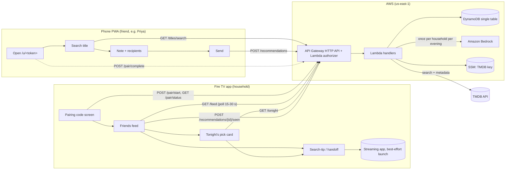

# Big picture: Gottawatch in one page

Source: [plan v2](../plan/MVP_PLAN_v2.md) §2–§6. This page summarizes; the plan wins on conflict.

## What it is

Friends **compose** recommendations on their phones (PWA). The household's Fire TV **acts** on them: a lean-back feed, one AI-assisted **Tonight's pick** grounded only in friends' notes, and a best-effort handoff to the streaming app. No login: seeded identities + a TV↔phone pairing code (ADR-0002).

## Components

| Component | Tech (per plan) | Responsibility | Spec |
|---|---|---|---|
| Fire TV app (`apps/tv`) | React Native for Fire OS **or** Vega (OPEN, ADR-0006) | Pairing screen, friends feed, Tonight's pick card, search-tip/handoff, Seen, About | [specs/tv-app.md](../specs/tv-app.md) |
| Phone PWA (`apps/web`) | Vite + React on S3 + CloudFront (ADR-0004) | Seeded profile link, pairing-code entry, title search, recommend + note, recipients | not yet written |
| API (`services/api`) | API Gateway HTTP API + Lambda authorizer + Lambda (Node/TS) | pair, feed, recommendations, seen, titles/search, tonight | not yet written (contract for TV in tv-app spec §4) |
| Data | DynamoDB single table (TTL for codes + pick cache) | households, users, friendships, devices, pair codes, recs, title cache, pick cache | plan §5 |
| AI | Amazon Bedrock (Converse API), small text model chosen Oct 14 | Tonight's pick: choose 1 of the household's candidates + 1–2 sentence grounded reason | ADR-0003 |
| Catalog | TMDB via server-side proxy; `CATALOG_MODE=tmdb\|demo` | Search + metadata; demo catalog of original titles for the video | plan §5, §7 |
| Ops | SSM (TMDB key), CloudWatch, AWS Budgets, CDK | Secrets, logs, cost alarms, IaC | plan §5 |

## Data flow

Key properties:
- The TV never talks to TMDB or Bedrock directly; only to our API with a bearer **device token**.
- Recommendations store denormalized metadata (title, year, poster, runtime, genres), so feed polls never re-query TMDB.
- Tonight's pick: cached per household per evening; any failure → "Most recommended this week" fallback (ADR-0003).
- Handoff never overlays another app; it is best-effort and always preceded by an in-app "Search for: <Title>" tip (ADR-0005).

## Milestone map (all ET unless noted)

| Date | Milestone (plan v2 §6) | Gate / done when |
|---|---|---|
| Wed Oct 7 – Thu Oct 8 | Toolchain hello world on simulator; Fire OS vs Vega decision; repo created | Hello world visible on simulator |
| Fri Oct 9 | AWS skeleton (CDK): pair/start, pair/complete, feed + seed script | curl pairing + seeded feed |
| Sat Oct 10 | Phone PWA: profile link, pairing entry, search proxy, send rec | Seeded friend sends a rec |
| **Sun Oct 11** | **Gate 1: end-to-end loop** (phone recommend → TV card on simulator/device) | TV shows a rec sent from the phone |
| Mon Oct 12 – Tue Oct 13 | TV feed polish, focus, posters, empty/error states, Seen | Comfortable D-pad demo |
| **Wed Oct 14** | **Tonight's pick** (Lambda + Bedrock + cache + fallback + TV card) | Bedrock pick shows; killing Bedrock shows fallback |
| Thu Oct 15 – Fri Oct 16 | Search-tip screen + best-effort launch + failure paths | Select never dead-ends |
| Sat Oct 17 – **Sun Oct 18** | Demo catalog + art, judge profile, README; **Gate 2: rehearsable demo + README a stranger can follow** | Gate 2 green |
| Mon Oct 19 | Buffer (Alexa stretch only if both gates green) | — |
| Tue Oct 20 – Wed Oct 21 | Video, Devpost draft, Product Feedback, friction log, name-collision check | Video public; draft saved |
| **Thu Oct 22** | **Code freeze (end of day)**; cold-start run-through; judge access test | Checklist (plan §10) green |
| **Fri Oct 23** | **Submit by 10:00am PT / 1:00pm ET** (hard deadline 12:00pm PT / 3:00pm ET) | Entry submitted |
| Oct 26 & Nov 9 | Backend health checks (judging start per schedule page / per rules) | Healthy |
| Fri Nov 20, 12:00pm PT | End of judging; backend must stay live until then | — |

### Where we actually are (Oct 11, 2026)

Facts only: this repo was created today with no code; the Fire TV toolchain has not been installed on the build box; AWS access for builds is pending an IAM access key from Kiran. So the Week 1 items scheduled for Oct 7–10 are **not done in this repo**, and Gate 1 (today) will not be green. Plan v2's buffer rule applies: "if the Oct 11 gate slips, cut stretch entirely and freeze visual polish," and Mon–Tue go to closing the loop. Whether to re-baseline the schedule is OQ-09 in [open-questions.md](../open-questions.md).

## Zoom levels

- **Zoomed out:** this page + [open-questions.md](../open-questions.md).
- **Mid:** ADRs in [decisions/](../decisions/).
- **Zoomed in:** [specs/tv-app.md](../specs/tv-app.md) → [tasks/tv-app-tasks.md](../tasks/tv-app-tasks.md).
